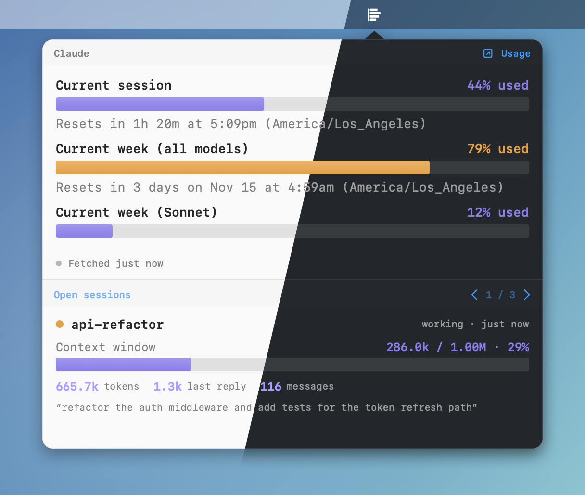
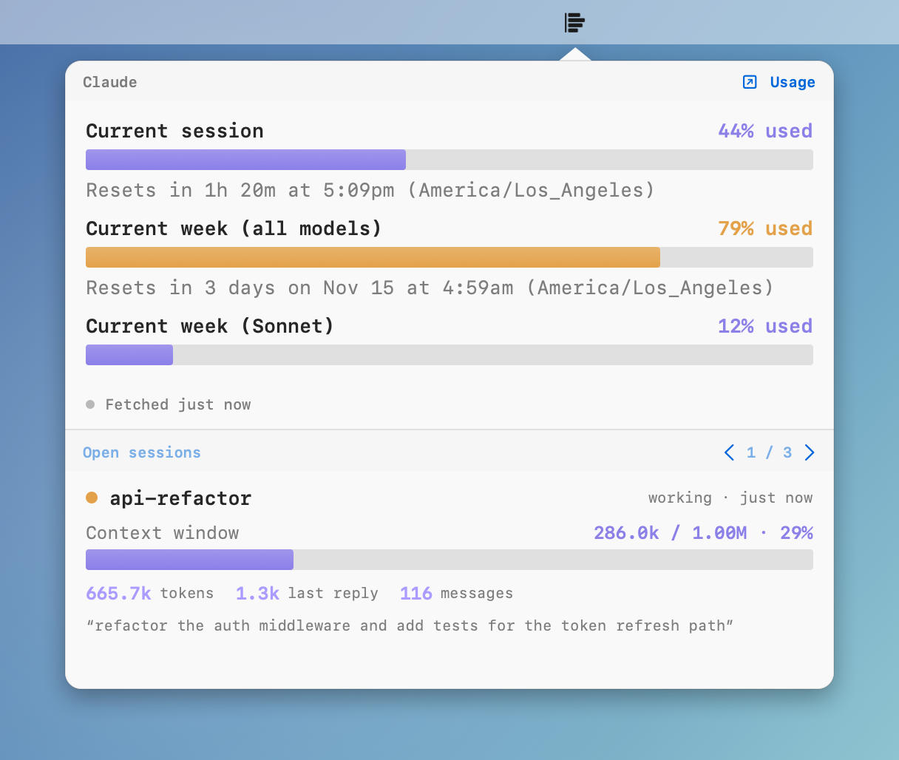
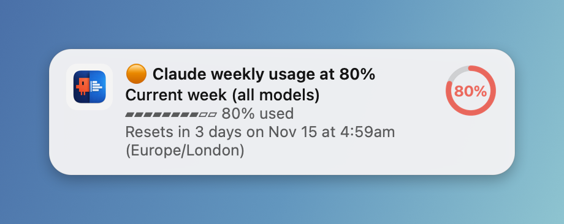

# CC Usage Bar

A minimal macOS menu bar app that shows your [Claude Code](https://claude.com/claude-code) and [OpenAI Codex](https://github.com/openai/codex) usage at a glance, stacked in one popover.



<p align="center">
  <picture>
    <source media="(prefers-color-scheme: dark)" srcset="static/dark.png">
    
  </picture>
</p>

## Why

Claude Code doesn't expose a persistent usage indicator. The only way to check is to open a session and type `/usage`. When you're running multiple Claude Code sessions across different terminal windows, checking your usage means either interrupting a running agent mid-task or opening a new terminal just to see a number. Both are disruptive. Codex has the same problem — `/status` only lives inside a running session.

Many community tools solve this by reading the OAuth token from the macOS Keychain and calling Anthropic's usage API directly. But macOS will prompt you every time a third-party app tries to access that Keychain item — not a smooth experience, and handing your OAuth token to another process is a legitimate security concern.

The original project was vibe-coded using Claude Code itself. This fork extends it to also cover Codex and adds structured parsing, threshold notifications, and a per-provider abstraction so additional CLIs can be added without rewriting the driving logic.

CC Usage Bar takes a different approach. It doesn't touch your Keychain or make any network calls itself. It simply runs `claude` (and optionally `codex`) the same way you would, captures the `/usage` or `/status` output, and displays it in your menu bar — one click away, always accurate.

## How it works

When you click the menu bar icon, CC Usage Bar opens a popover containing an embedded terminal. Behind the scenes it:

1. Spawns a real CLI session in a pseudo-terminal (PTY) — `claude` for Claude Code, `codex` for Codex
2. Sends the provider's usage command automatically (`/usage` for Claude, `/status` for Codex)
3. Captures the output and renders it with full ANSI color fidelity — exactly as it appears in your terminal
4. Parses the captured output into structured metrics (percent used, reset times, credits) for the native UI, with the raw terminal output available as a fallback
5. Terminates the session immediately after (Claude's session is reused across refreshes; Codex spawns fresh each time)

There is no API scraping, no token parsing, no reverse engineering. The data comes straight from the CLIs themselves, so it is always 100% accurate and reflects the latest state.

For the full technical writeup — including the non-obvious Codex discovery (ratatui's char-by-char cursor positioning breaks string-based banner detection, so Codex is driven on timers instead) — see [`docs/CODEX_INTEGRATION_NOTES.md`](docs/CODEX_INTEGRATION_NOTES.md).

## Features

- 🪶 **Minimal** — a single menu bar icon, one popover, no windows
- 🤖 **Multi-provider** — Claude Code and Codex stacked in one view, each driven by its own CLI session
- 🎯 **Accurate** — reads directly from each CLI's own `/usage` or `/status` output
- 🧵 **Open sessions** — see every running Claude Code session at a glance: working or idle, context window fill, tokens used, last reply size, message count, and the last thing you asked. Cycle through them with the arrows or ← / →
- 🔌 **Only what you use** — a CLI that isn't installed (say, Codex) gets no panel, and the popover resizes to fit what's shown
- ⌨️ **Global hotkey** — ⌃⌥⌘U toggles the popover from anywhere
- 🔔 **Threshold alerts** — native macOS notifications when any usage limit crosses 60% / 80% / 100%, even while the popover is closed
- 🔒 **Safe** — no API calls, no credentials stored, no hacks; just runs the CLIs the same way you would
- ⚡ **Zero setup** — install, open, click the icon (requires the relevant CLI already configured on your machine)
- 🍎 **Native** — built in Swift with SwiftUI, runs as a lightweight menu bar agent

## Requirements

- macOS 12 Monterey or later (Intel or Apple Silicon)
- [Claude Code](https://docs.anthropic.com/en/docs/claude-code) installed and logged in (`claude` must be available as a shell command)
- (Optional) [Codex](https://github.com/openai/codex) installed and logged in (`codex` must be available as a shell command) — if it isn't installed, its panel is simply hidden

CC Usage Bar is a macOS GUI app, so it cannot rely on the same interactive shell
environment your Terminal has. On launch it bootstraps common CLI locations,
including Homebrew (`/opt/homebrew/bin`, `/usr/local/bin`), native installer
paths (`~/.local/bin`), and common Node/version-manager paths (`fnm`, `nvm`,
`asdf`, `mise`, `nodenv`, `volta`, `pnpm`, `yarn`, npm global prefixes). If you
installed a CLI somewhere custom, symlink it into one of those locations or add
that directory to a login-shell PATH.

## Install

### Download (recommended)

1. Download the latest `CCUsageBar.zip` from the [Releases](../../releases) page
2. Unzip and move `CCUsageBar.app` to your `/Applications` folder

> **Note:** Since this app is not notarized, macOS Gatekeeper will block it on first launch.
> To open it, either:
> - Right-click the app → **Open** → **Open**
> - Or run in Terminal: `xattr -d com.apple.quarantine /Applications/CCUsageBar.app`

### Build from source

With Xcode:

1. Clone the repository
2. Open `CCUsageBar/CCUsageBar.xcodeproj` in Xcode
3. Build and run (Cmd+R)

Without Xcode (Command Line Tools only):

```bash
./build.sh        # build into ./build/CCUsageBar.app
./build.sh --run  # build, kill any running instance, and relaunch
```

The app runs as a menu bar agent — there is no Dock icon. Look for the chart icon in your menu bar.

## Usage

- **Left-click** the menu bar icon to open the usage popover
- **Click anywhere outside** the popover to dismiss it
- **Right-click** the menu bar icon to quit

Each time you open the popover, it fetches fresh usage data. A background refresh also runs every 5 minutes so cached values stay warm.

### Threshold notifications

<p align="center">
  <picture>
    <source media="(prefers-color-scheme: dark)" srcset="static/notification-dark.png">
    
  </picture>
</p>

CC Usage Bar posts a native macOS notification when a usage metric crosses **60%, 80% or 100%**, so you find out before you hit a limit. Each alert is laid out to be readable at a glance:

```
🟠 Claude weekly usage at 80%
Current week (all models)
▰▰▰▰▰▰▰▰▱▱ 80% used
Resets in 3 days on Nov 15 at 4:59am (Europe/London)
```

The emoji steps 🟡 / 🟠 / 🔴 with the threshold (the 100% alert reads "limit reached"), the subtitle names the exact metric, and the banner carries a progress ring in the same violet / amber / coral as the popover bars. Alerts are grouped per provider in Notification Center. It works for every percentage-based limit it tracks (Claude's session and weekly limits, Codex's 5h and weekly limits), and each metric is tracked separately.

- **Once per threshold, per window.** Each threshold fires once per reset window and re-arms when the window resets. If usage jumps past two thresholds in one refresh, you get one notification for each.
- **Only on a real crossing.** It compares the previous reading with the current one. When the app first starts (or a window has just reset) it only records a baseline, so launching it while you're already at 85% won't alert you.
- **Checked on every refresh**, so with the popover closed that's the 5-minute background refresh. A short spike between two refreshes can be noticed late, but it won't be missed.
- **Permission.** macOS asks for notification permission the first time one is needed. You can change it later in **System Settings → Notifications → CCUsageBar**.

### Open sessions

Below the usage panels, **Open sessions** shows one Claude Code session at a time. Use the `‹ ›` arrows (or the ← / → keys) to cycle through them:

- **Status** — working or idle, and how long ago it last changed
- **Context window** — how full the session's context is, as a bar (amber from 60%, coral from 80%)
- **Tokens** — total tokens used (input + output + cache writes), the size of the last reply, and the message count
- **Last prompt** — the most recent thing you typed in that session

This is read locally from Claude Code's own files (`~/.claude/sessions` for which sessions are open, and each session's transcript in `~/.claude/projects` for token counts). Nothing leaves your machine, and only Claude Code sessions are covered (Codex isn't yet).

The context window size isn't recorded in the transcripts, so it's assumed: 1M tokens for the 5.x models, 200k otherwise (raised to 1M if a session has already used more than 200k). Treat the percentage as an estimate.

## Acknowledgements

Forked from [lionhylra/cc-usage-bar](https://github.com/lionhylra/cc-usage-bar), which covers Claude Code only. This fork adds Codex support, the `Provider` abstraction, structured parsing, threshold notifications, open-session tracking, wider macOS support, and the refreshed UI. The original PTY-driving approach and ANSI rendering are theirs.

## License

MIT

---

⭐ If this tool helps you avoid hitting Claude or Codex limits, consider giving it a star!
